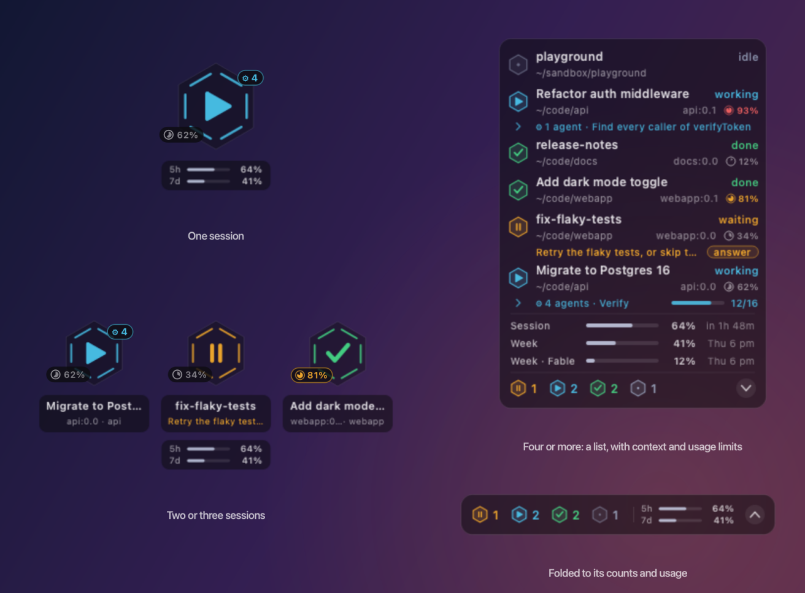
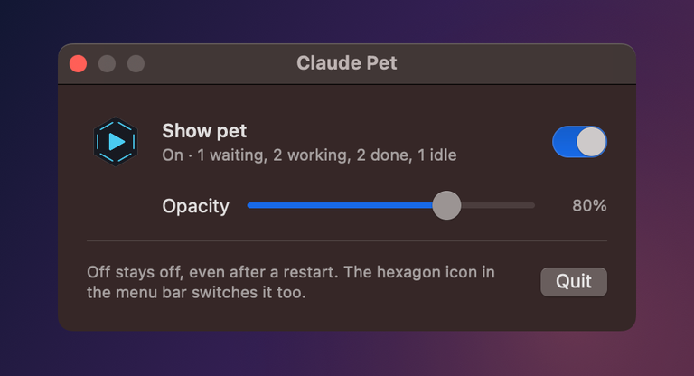

# CTally

A floating status light for your Claude Code sessions on **macOS and Ubuntu**: **whose turn is it?**
Glance over instead of tabbing back to the terminal.

```sh
pipx install ctally
ctally setup --tmux
```

The name comes from the *tally light*, the lamp on a broadcast camera that shows it's live, and from tallying
up your sessions.



Every session gets a hexagon whose glyph and color say what it's doing:

| | State | Meaning |
|---|---|---|
| ▶ cyan | **working** | Claude's turn: it's working, or its subagents or a workflow still are |
| ⏸ amber | **waiting** | your turn: a permission prompt, a question or a plan to approve, or it's waiting for input |
| ⏸ amber | **limit** | stopped by your plan's usage limit; it turns to done when the limit resets |
| ✓ green | **done** | your turn: the turn finished, and it stays here until your next prompt |
| • slate | **idle** | nothing running |

And a small gauge beside each one says **how full its context window is**: `62%`, turning amber at 75% and
red at 90%, so you see a session nearing compaction before it gets there. [More below.](#context-window)

## Features

- **Floats above everything** without ever taking keyboard focus; on macOS on every Space and beside
  full-screen apps too.
- **One to three sessions show as big badges**; four or more become a compact list with each session's
  name and directory. Past 16 rows (or the screen's height) it scrolls, with a scroll bar that marks the
  sessions waiting on you. Session names come from `/rename`, or else the title Claude gave the session.
- **Sees subagents and workflows**: while a session's agents run, its row says how many and what they're up
  to (`4 agents · Verify`), with a progress bar for a workflow, and its badge carries the count.
  [More below.](#subagents-and-workflows)
- **Answer without switching**: a session waiting on you says what for, a tool to allow
  (`Allow Bash(npm publish)?`), a question or a plan, and in tmux you answer it from CTally with the
  choices Claude Code shows. [More below.](#answering-from-ctally)
- **Your plan's usage limits**: the session, the week, and each model's week, as bars with when each
  resets, kept fresh after every reply. [More below.](#usage-limits)
- **How full each session's context window is**: a small gauge on every row and badge fills as the
  conversation grows, turning amber at 75% and red at 90%, before Claude Code compacts it. These are Claude
  Code's own numbers. [More below.](#context-window)
- **Your week with Claude**: `ctally stats` adds up, day by day, how long Claude worked and how long it
  waited on you, your prompts, finished turns and limit hits. [More below.](#your-stats)
- **Built for tmux**: every row shows its pane, a click switches to it, **prefix + J** jumps to the session
  that needs you, and the counts can sit in tmux's status line. [More below.](#built-for-tmux)
- **Click a row to bring that session's terminal forward**: the exact tmux pane, and on macOS the exact
  Terminal tab.
- **Fold the list** down to a bar of counts with the chevron.
- **When a turn finishes**, its row washes green and its mark bounces once; then everything holds still.
- **Menu bar (or top bar) icon** to show or hide CTally. Off stays off across restarts, and the app sits idle
  with no timers.
- **Settings window** with an on/off switch, an opacity slider (80% by default), and a switch for the usage
  limits.
- **Silent**: no sounds, no notifications, no Dock icon.
- **One Python package**, installed with pipx: the same Qt app on macOS and Linux, and a `ctally` command for
  the terminal and tmux.



## Subagents and workflows

When a session hands work to subagents, or runs a whole workflow of them, CTally follows along:

- **The row grows a line about its agents**: how many are running, and what they're doing. For a workflow
  that's the phase it has reached (`4 agents · Verify`), with a progress bar of its agents finished out of
  those started so far (`12/16`; the total grows as each phase sets off more). For a single agent it's the
  task it was given (`1 agent · Find callers of parseConfig`).
- **Click that line for a closer look**: a workflow's phases, each with its own progress bar and the agents
  still at work in it (`Verify  verify:schema, verify:queries  0/4`), or each agent and what it's doing
  (`Explore · Find callers of parseConfig`). Click again to fold it away. Hover over a badge for the same.
- **The badge carries the count** (`⚙ 4`) on its shoulder.
- **The session stays working until its agents are back.** A session that sends agents off in the background
  finishes its own turn at once, and would otherwise look done for as long as they run, sometimes hours. CTally
  keeps it cyan until they return and Claude has taken in their results, and prefix + J leaves it alone till
  then.
- **Stopping by hand counts.** Press Esc, dismiss a question, or kill agents or a workflow, and Claude Code
  runs no hook to say so. CTally reads it from the transcripts instead: the session shows **done** within a
  couple of seconds (or **working** again, if you dismissed a question while its agents were still at it),
  and the agents you stopped leave the agents line.

`ctally list` shows the count too. This needs the subagent hooks that `ctally setup` adds; if you set up
CTally before they existed, run `ctally setup` again and restart your sessions.

## Answering from CTally

A session waiting on you says what for, on a line under its row (or on its caption, among the badges):

- a tool to allow, the way Claude Code shows it: `Allow Bash(npm publish)?`, `Allow Write(src/db.py)?`
- a question Claude asks you: `Which colour do you prefer?`
- a plan to approve: `Approve the plan: Add a dark mode toggle`

Hover over the session for more: the whole command, every question and its options, the plan's first lines.
The session stays waiting for as long as that's on screen, even while its subagents or a workflow work on
behind it.

**In tmux you can answer it from CTally.** Click that line, or right-click the session, and pick from the
choices Claude Code is showing: `1. Yes`, `2. Yes, and don't ask again…`, `3. No`. CTally reads them off the
session's tmux pane, just as you'd see them, and types your pick there, after checking the same choices are
still on screen, so a key never lands anywhere else. Choices that leave you something to type (`Type
something`, `Tell Claude what to change`) bring the terminal forward for it. A form of several questions
takes one answer at a time, then its review.

Outside tmux, the menu shows what's asked and takes you to the terminal to answer it.

## Context window

Every session shows how much of its context window it has used: a little pie that fills clockwise, and the
percentage beside it.

- **In the list** it ends the row's directory line (`webapp:0.0  ◔ 34%`); **on a badge** it sits on the
  lower-left shoulder.
- **Colours**: quiet grey while there's room, amber from 75%, red from 90%. Claude Code compacts a
  conversation when it's nearly full, so an amber or red session is one to wrap up, or to `/compact` yourself
  at a good moment.
- **Hover over the session** for the tokens: `Context 62% full: 124k of 200k tokens`. A 1M-token window
  shows as `of 1M`, and fills that much more slowly.
- **`ctally list`** has it as a column, between the agents and the project.

The numbers are Claude Code's own: after every reply it hands the status line each session's
`context_window` (its size, what's in it, the share used), and CTally's status line keeps the latest per
session in `~/.claude/ctally.d/.status/`. A session shows its gauge from its next reply once that status
line is in place: after upgrading from 0.3.2 or earlier, run `ctally setup` again (sessions already running
pick it up without a restart). With `--no-statusline` there's no gauge.

Claude Code counts from the replies it has had, so a session you've just reopened on an earlier conversation
(`claude --resume`, `--continue`) reports nothing in its window until its next reply. CTally shows no gauge
for it till then, rather than a `0%` that isn't so.

## Usage limits

CTally shows your plan's usage limits the way Claude Code's `/usage` does: the current session (the
five-hour window), the week across all models, any per-model weekly limit (Fable, say), and usage credits if
you've switched them on.

- **The list** gives every limit a line between the sessions and the count bar: a bar, the share used, and
  when it resets (`in 1h 48m`, `Sat 10 pm`).
- **The folded bar and the badges** carry two small meters, the session (`5h`) and the week (`7d`).
- **Hover over any of them** for the details, and how fresh they are. The menu bar (top bar) icon's menu
  lists them too.
- **Colours**: a bar turns amber at 75% and red at 90%. Numbers more than an hour old are dimmed.
- **Hitting a limit** shows it at 100% at once, and the sessions it stopped as **limit**. A prompt you send
  before it resets doesn't make them look busy, because it can't get through. A limit reset early starts a new
  window, and the meter follows it from the next reply.
- **More than one account**: the limits are the account's you're signed in to. Sign in to another, or swap
  accounts under the sessions that are running (with a tool like `claude-swap`), and within a couple of
  seconds the meters are that account's, as CTally last saw them: nothing to wait for if you've used it
  before, and its first reply if you haven't. Switch back and the first one's are there again.
- **tmux's status line** gets `5h 71% 7d 49%` after the counts, coloured the same way, and `ctally usage`
  prints the lot:

```console
$ ctally usage
Current session            ███████░░░  71%  resets 7:30 pm (in 2h 25m)
Current week (all models)  █████░░░░░  49%  resets Sat Oct 10, 10 pm
Current week (Fable)       ░░░░░░░░░░   0%  resets Sat Oct 10, 10 pm
Updated just now
```

Where the numbers come from: Claude Code passes the session and week limits to its status line after every
reply, so `ctally setup` adds a status line that hands them to CTally and shows nothing itself (a status
line you already had keeps showing; CTally's runs it). Everything else comes from the copy of the `/usage`
numbers Claude Code keeps in `~/.claude.json`, which it refreshes only now and then. Limits apply to Pro,
Max and Team plans; with an API key there are none to show.

Claude Code doesn't say which account a session's numbers are for, and a session keeps handing over the
ones from its last reply, hours later and accounts later. So CTally keeps the latest for each account
apart, and tells them by their week: every account's week ends at its own time. Numbers from a session
that hasn't replied since you changed accounts go with the account they came from, not the one you're on.

Turn the limits off with the switch in Settings, or right-click → Hide Usage Limits. That hides them from tmux
too. `ctally setup --no-statusline` leaves the status line out; the limits then refresh only when Claude Code
refreshes its copy.

## Your stats

`ctally stats` adds up the last week (or `--days 30`) from a small history CTally's hook keeps:

```console
$ ctally stats
             working  waiting on you  prompts  turns  sessions  limit hits
Thu Oct 22    4h 10m             12m       41     38         6           -
…
Today         1h 43m              2m        3      3         2           -
Last 7 days  21h 36m          1h 05m      284    261        31           1

Claude worked 21h 36m in all, with up to 6 sessions at once (Tue 3:40 pm); something was working for 11h 20m.
You answered what it asked in 48s, and came back to finished turns in 3m (medians).
History since Oct 22.
```

- **working** adds up every session's time, so sessions running side by side count twice; the line under
  the table says how long *something* was working.
- **waiting on you** is time a session sat on a permission, a question or a plan. Time after a finished
  turn isn't counted there: that's your turn, not Claude being stuck. How soon you got back to it is the
  median at the bottom (only within two hours; longer, and you'd moved on).
- `--json` gives the same, with times in seconds.

The history starts once the hook from 0.3.3 is set up (`ctally setup`, then restart your sessions), and keeps
90 days.

## Built for tmux

Running a dozen Claude Code sessions across tmux sessions and split panes is exactly what CTally is for.
It knows where each one lives, because tmux leaves `TMUX` and `TMUX_PANE` in the environment of everything
started inside it.

- **Every row shows its pane.** `webapp:0.1` is tmux session `webapp`, window 0, pane 1, and it sits next to
  the directory, so two sessions in the same folder are easy to tell apart.
- **Click a row** and tmux switches to that exact pane. Then the Terminal tab attached to that tmux session
  comes forward, or a new Terminal window attaches to it if no tab shows it.
- **prefix + J jumps to the session that needs you**, without touching the mouse: waiting sessions first,
  then finished ones, longest-waiting first, passing over those stopped by the usage limit. Press it again
  for the next one.
- **The counts sit in tmux's status line** (`!1 ▶2 ✓5`: waiting, working, done), and they change the moment a
  session does. Your plan's session and week usage follow them (`5h 71% 7d 49%`).

Turn on the key and the status line with:

```sh
ctally setup --tmux
```

This adds a marked block to `~/.tmux.conf` and applies it to your running tmux at once. The file is backed
up first, and `ctally uninstall` takes the block out again. To set it up by hand instead:

```tmux
bind-key J run-shell -b "'$HOME/.local/bin/ctally' jump '#{pane_id}' '#{client_name}' '#{socket_path}'"
set -ag status-right ' #($HOME/.local/bin/ctally status --tmux)'
set -g status-right-length 80
```

The same `ctally` command works in any shell (it's installed to `~/.local/bin`):

```console
$ ctally list
waiting  webapp:0.0       -         34%  webapp                   5f3c…
done     webapp:0.1       -         81%  webapp                   9a1e…
working  api:0.0          4 agents  62%  api                      c27d…
$ ctally status
!1 ▶1 ✓1
$ ctally usage         # your plan's usage limits
$ ctally stats         # the last week: Claude's time and yours
$ ctally jump          # inside tmux: go to the session that needs you
```

## Requirements

- macOS 12 or later, or Ubuntu 22.04 or later (other Linux desktops should work too; see [Ubuntu](#ubuntu))
- Python 3.9 or later and [pipx](https://pipx.pypa.io). Qt comes ready-built for each system, and the newest
  Python can be ahead of what's built for an older one: macOS 12 runs CTally with Python up to 3.13, macOS 13
  up to 3.14, and macOS 14 or later, Ubuntu 22.04 or later and Windows up to 3.15. If pipx's own Python is
  newer than yours takes, name one: `pipx install --python python3.14 ctally`.
- Claude Code

## Install

```sh
pipx install ctally
ctally setup            # or: ctally setup --tmux
```

pipx puts CTally in an environment of its own, with Qt (PySide6, about 100–400 MB depending on the platform),
and the `ctally` command in `~/.local/bin`. Then `ctally setup` does four things:

1. Copies the hook and status line scripts to `~/.claude/hooks/` (`ctally.sh`, `ctally-statusline.sh`).
2. Adds the hooks and the status line to `~/.claude/settings.json`. It merges with your existing settings and
   backs the file up first. A status line you already had is kept, and still shows.
3. Starts CTally at login: a LaunchAgent on macOS, an autostart entry (`~/.config/autostart`) on Linux.
4. Starts CTally now.

Restart any Claude Code sessions that were already running so they pick up the hooks.

| Option | Effect |
|---|---|
| `--tmux` | also set up tmux: the prefix + J jump key and status-line counts ([details](#built-for-tmux)) |
| `--no-hooks` | leave `~/.claude/settings.json` alone (add the hooks yourself; see below) |
| `--no-statusline` | no status line: the [usage limits](#usage-limits) refresh only when Claude Code refreshes them |
| `--no-autostart` | don't start CTally at login |
| `--no-launch` | set up without starting CTally now |

To upgrade: `pipx upgrade ctally`, then `ctally setup` again. It restarts CTally and keeps your preferences.
For the latest commit, before it's released: `pipx install --force git+https://github.com/JinyuJinyuJinyu/ctally.git`
(or, keeping the Qt you have, `pipx runpip ctally install --no-deps --force-reinstall git+https://github.com/JinyuJinyuJinyu/ctally.git`),
then `ctally setup`. Its version ends in `.dev0`, and `pipx upgrade` leaves it until the next release.

**Upgrading from the Swift version** (CTally.app, installed with `./install.sh`): remove the old `ctally`
script first, since pipx won't replace a file it didn't put there: `rm ~/.local/bin/ctally`. Then install as
above. `ctally setup` quits and removes `~/Applications/CTally.app` and its login item, and keeps your opacity,
fold setting and position.

### Ubuntu

```sh
sudo apt install pipx libxcb-cursor0
pipx ensurepath          # then open a new terminal
pipx install ctally
ctally setup --tmux
```

`libxcb-cursor0` is the one library Qt needs that a desktop install of Ubuntu lacks.

- **Wayland** (Ubuntu's default) lets no app keep itself on top or choose where its window goes, so CTally
  runs through XWayland, which allows both. That happens on its own; you don't need to switch sessions.
- **The top-bar icon** uses Ubuntu's AppIndicator support, which is on by default. On a desktop without a
  tray, right-click the indicator itself for the menu.
- **Clicking a session** switches tmux to its pane, and opens a terminal on that tmux session if none shows
  it. Raising the terminal's window works on X11 with `xdotool` installed (`sudo apt install xdotool`);
  under Wayland no app may raise another's window, so bring the terminal up yourself. prefix + J needs
  neither.

## Using it

| To | Do this |
|---|---|
| Move it | Drag it anywhere. It remembers the spot and grows left from there, and away from the nearer screen edge: up from the bottom half of the screen, down from the top half, where the list unfolds downward. |
| Go to a session | Click its row (or its badge). |
| See what a session's agents are doing | Click the line about its agents; again to fold it. |
| Answer a session waiting on you | Click the amber line saying what it asks, or right-click the session, and pick a choice. In tmux. |
| Jump to the session that needs you | In tmux, press prefix + J (set up by `ctally setup --tmux`). Again for the next one. |
| Fold or unfold the list | Click the chevron on the count bar, or right-click → Fold List. |
| Hide or show it | Use the hexagon in the menu bar (top bar on Ubuntu), or right-click → Hide CTally. |
| Change opacity | Menu bar → Settings…, or right-click → Settings… |
| See your usage limits | Hover over them. Hide them with right-click → Hide Usage Limits, or in Settings. |
| Start or stop it | `ctally run` starts it; Quit in its menu stops it. |
| Name a session | Run `/rename my-name` in Claude Code. CTally picks the name up within seconds. |

**The first time you click a session** on macOS, macOS asks whether CTally (shown as Python, which runs it) may
control Terminal. Allow it so CTally can bring the right tab forward. You can change this later in
**System Settings → Privacy & Security → Automation**.

## How it works

```
Claude Code ──hooks──▶ ~/.claude/ctally.d/<session id> ──read 2×/s──▶ ctally run
            ──status line──▶ ~/.claude/ctally.d/.usage/…  ───┤
            ──its own list──▶ ~/.claude/sessions/<pid>.json ─┘
```

Two pieces, connected by a folder:

1. **Hooks.** `ctally.sh` (in `src/ctally/hooks/`) runs on Claude Code events and writes one small file per session:
   `working <pid> <project>`.

   | Event | State written |
   |---|---|
   | `UserPromptSubmit` | `working` |
   | `PreToolUse` | `working` (a tool is about to run); not while another part of the session has a question up |
   | `PostToolUse` / `PostToolUseFailure` | `working` (back to work after a permission prompt), once it's the tool that was asked about |
   | `PermissionRequest` | `waiting`, the moment a permission, a question or a plan to approve is on screen; what's asked goes in `~/.claude/ctally.d/.asks/<session id>` until it's settled |
   | `Stop` | `done`, or still `working` if subagents or a workflow run on in the background |
   | `StopFailure` | `limited` when the usage limit stopped the turn; `waiting` for a login or billing problem; else `done` |
   | `Notification` | `waiting` (a permission prompt still open); idle input after a turn that never ended, as Esc leaves it, means `done` |
   | `SessionEnd` | removes the file |
   | `SubagentStart` / `SubagentStop` | adds / removes a file per agent in `~/.claude/ctally.d/.agents/<session id>/` |

   A `waiting` never overwrites `done`: Claude Code also sends its idle notification after a turn ends. Nor
   does the idle notification count while the session's agents are still out.
   A session with a permission, a question or a plan on screen stays `waiting` until that's settled: the tool
   asked about has run or failed, whoever asked (Claude, or the agent of its that did) has gone on to another
   tool, the turn is over, or you've sent a new prompt. Its other agents carrying on meanwhile, and tools
   started alongside the one asked about, change nothing.
   A usage limit hit is also noted in `~/.claude/ctally.d/.limit`: what Claude Code said, when the limit
   resets, from the status line, and the account it was hit on. Until then a new prompt leaves the session
   `limited`, and the limit shows as used up, unless you've changed accounts since. The note goes once a
   turn gets through on that account (the session's own, or another session's that has done something since
   the limit was hit: a reply already on its way then shows nothing), Claude Code says the limit has reset,
   or the status line shows a new window.
   Esc and killed agents get no hook, so CTally also reads the end of each busy session's transcript, and of
   its agents' transcripts: a stop there with nothing after it means the turn is over, and an agent whose
   transcript ends interrupted (or that Claude Code marks `stoppedByUser`) is gone.
   Inside tmux, a change of state also redraws tmux's status lines, so the counts there update at once.
   For `ctally stats`, each change of state, each prompt, and every five minutes of a lasting one, gets a
   line in `~/.claude/ctally.d/.history/<date>`: the time, the session id and the state.

   **The status line.** `ctally-statusline.sh` saves what Claude Code hands its status line whenever it
   includes the usage limits: the latest for each account, in `~/.claude/ctally.d/.usage/<account id>` (the
   id `~/.claude.json` gives the account signed in), and the latest for the one signed in also in
   `~/.claude/ctally.d/.statusline`, where the hook looks up when a limit resets. Each session hands over the
   numbers from its own last reply, on whichever account that was, and an idle one redraws its line now and
   then with numbers hours old. So a reading goes by its week: for a week already kept, it belongs to that
   account, and replaces what's kept only if it's newer (more used in the same session window, or a session
   window where the kept one has ended). For a week not seen before it's the account signed in's, if it's
   news, which is to say not what that session said last time. It also saves each session's latest to
   `~/.claude/ctally.d/.status/<session id>`, for how full that session's context is and to tell its news
   by. It prints nothing, or runs the status line you had before and prints what that prints.

2. **The app.** It polls the folder twice a second, checking modification times first so unchanged files
   aren't re-read. Sessions whose process has exited drop off the display. The exception is when nothing else
   is running: a finished one stays so you can still see it. Leftover files are cleaned up after a day. The
   usage limits it checks every two seconds, the same way.

   The hooks hear of a session only once it does something, so the app also reads Claude Code's own list of
   its running sessions, `~/.claude/sessions/`. A session the hooks haven't heard from yet, idle since setup or
   never sent a prompt, shows from there: idle, or working or waiting as Claude Code has it. Once its hooks
   run, they say. Background jobs count too, but not the spare processes Claude Code starts ahead of need. A
   session sent to the background goes on as a job under a new id: CTally shows it once, in the terminal
   that sent it, which is where clicking it takes you. The list also says when a session went idle without
   a word to the hooks, as a job can after a prompt it never answers: one the hooks last heard working is
   then done, unless its agents are still at work. Sessions are listed oldest first, by when they started.

To add the hooks by hand, copy `src/ctally/hooks/ctally.sh` and `ctally-statusline.sh` to `~/.claude/hooks/`
and merge this into `~/.claude/settings.json` (to keep a status line you have, put its command after
CTally's as one quoted argument: `"\"$HOME/.claude/hooks/ctally-statusline.sh\" 'your command'"`):

```json
{
  "statusLine": { "type": "command", "command": "\"$HOME/.claude/hooks/ctally-statusline.sh\"" },
  "hooks": {
    "UserPromptSubmit": [{ "hooks": [{ "type": "command", "command": "\"$HOME/.claude/hooks/ctally.sh\" working" }] }],
    "PreToolUse":       [{ "hooks": [{ "type": "command", "command": "\"$HOME/.claude/hooks/ctally.sh\" working" }] }],
    "PostToolUse":      [{ "hooks": [{ "type": "command", "command": "\"$HOME/.claude/hooks/ctally.sh\" working" }] }],
    "PostToolUseFailure": [{ "hooks": [{ "type": "command", "command": "\"$HOME/.claude/hooks/ctally.sh\" working" }] }],
    "PermissionRequest": [{ "hooks": [{ "type": "command", "command": "\"$HOME/.claude/hooks/ctally.sh\" asking" }] }],
    "Stop":             [{ "hooks": [{ "type": "command", "command": "\"$HOME/.claude/hooks/ctally.sh\" done" }] }],
    "StopFailure":      [{ "hooks": [{ "type": "command", "command": "\"$HOME/.claude/hooks/ctally.sh\" failed" }] }],
    "Notification":     [{ "hooks": [{ "type": "command", "command": "\"$HOME/.claude/hooks/ctally.sh\" waiting" }] }],
    "SessionEnd":       [{ "hooks": [{ "type": "command", "command": "\"$HOME/.claude/hooks/ctally.sh\" end" }] }],
    "SubagentStart":    [{ "hooks": [{ "type": "command", "command": "\"$HOME/.claude/hooks/ctally.sh\" agent-start" }] }],
    "SubagentStop":     [{ "hooks": [{ "type": "command", "command": "\"$HOME/.claude/hooks/ctally.sh\" agent-stop" }] }]
  }
}
```

### Privacy

Everything stays on your machine. The app makes no network requests. To show session names it reads each
transcript in `~/.claude/projects/`, but only two parts:

- the last 256 KB, for the `/rename` name or the generated title
- the first 256 KB, once, for the directory the session started in

While agents run it also reads, beside the transcript, a running workflow's progress journal (for its phases,
its agents' labels and how many are done) and each running subagent's one-line task description. It never
reads your conversations otherwise.

While a session waits on you, the hook keeps what it asked (the tool and its input, the questions, or the
plan) in `~/.claude/ctally.d/.asks/`, and deletes it once that's settled. To answer from CTally, it reads the
screen of that session's tmux pane when you open the menu, and types only the digit you pick.

For how full each session's context is, it reads the latest its status line was handed for that session
(which also holds the model, the session's cost so far and its folder; CTally uses only the context numbers).
For the usage limits it reads what its status line saved, and from `~/.claude.json` only the cached `/usage`
numbers and your account's id, to show the numbers that are that account's (the status line and the hook
read the id there too, and name files by it). It never touches your credentials.

The history behind `ctally stats` holds nothing but times, session ids and states, and is kept for 90 days.

To list sessions the hooks haven't heard from, it reads Claude Code's list of running sessions in
`~/.claude/sessions/`: each one's id, process, folder, status and start time.

### Terminal support

On macOS, clicking a session works best in **Terminal.app**, with or without tmux: CTally finds the exact tab, or the
exact tmux pane and the tab attached to it. In other terminals (iTerm2, VS Code, …) and for sessions in the
Claude desktop app, it still switches tmux to the right pane and brings the app forward, but can't pick the
tab. On Linux, see [Ubuntu](#ubuntu). The prefix + J jump key works in any terminal.

## Uninstall

```sh
ctally uninstall
pipx uninstall ctally
```

The first removes the hooks and status line in `~/.claude/settings.json` (putting back a status line you had)
and the block in your tmux config, both after a backup, then the scripts, starting at login, the state files
and the preferences. Your other Claude Code and
tmux settings are left as they are. The second removes the command and its Qt.

## Troubleshooting

- **`pipx install ctally` says "No matching distribution found for PySide6-Essentials".** Your Python is
  newer than any Qt built for your system (see [Requirements](#requirements)). Install with an older one:
  `pipx install --python python3.14 ctally`. The same goes for `pipx reinstall` after your default Python moves on.
- **CTally doesn't change state.** Restart your Claude Code sessions after installing. Then check that
  `~/.claude/ctally.d/` gets a file when you send a prompt.
- **Clicking a session does nothing.** On macOS, allow Python (which runs CTally) to control Terminal under
  **System Settings → Privacy & Security → Automation**.
- **prefix + J says "nothing needs you".** That means no session is waiting or done; `ctally list` shows what
  CTally sees. A session started outside tmux can't be jumped to.
- **CTally is gone.** Use the hexagon icon in the menu bar → Show CTally. If the icon is gone too, it isn't
  running: run `ctally run`. Its log is `~/Library/Logs/ctally.log` on macOS and
  `~/.local/state/ctally/ctally.log` on Linux.
- **No context gauge.** It needs CTally's status line (not with `--no-statusline`), a version of it from 0.3.3
  on (run `ctally setup` again after upgrading), and a reply in that session since: since it was reopened,
  too, if it's a conversation you resumed.
- **No usage limits.** They need a Pro, Max or Team plan, and a reply in some session since CTally's setup
  (restart sessions that were running then). `ctally usage` shows what CTally has. Just after changing to
  an account CTally hasn't seen, there are none until its first reply.
- **The limits look like another account's.** After upgrading from 0.3.4 or earlier, run `ctally setup`
  again: it's the newer status line script that tells accounts apart.
- **Ubuntu: "Could not load the Qt platform plugin xcb".** Install the library it names, usually
  `sudo apt install libxcb-cursor0`.

## Developing

```sh
python3 -m venv .venv && .venv/bin/pip install -e . pytest
.venv/bin/ctally run                 # the indicator, from your checkout
.venv/bin/python -m pytest tests     # the tests
.venv/bin/python tools/snapshot.py   # the README's screenshots, from demo data
```

Every push runs the tests and pyflakes on GitHub (`.github/workflows/test.yml`), on Ubuntu with Python 3.9 and
3.15 and on macOS with 3.15.

Set `CTALLY_STATE_DIR`, `CTALLY_PROJECTS_DIR`, `CTALLY_SESSIONS_DIR`, `CTALLY_CONFIG_DIR` and
`CTALLY_CLAUDE_JSON` to run it against other folders than `~/.claude/ctally.d`, `~/.claude/projects`,
`~/.claude/sessions` and its own settings, and another file than `~/.claude.json`.

## Releasing

Releases go to PyPI from GitHub, by `.github/workflows/publish.yml`, using PyPI's Trusted Publishing: PyPI
trusts that workflow in this repository, so no token is stored anywhere.

Pushing doesn't release anything. Between releases, `__version__` in `src/ctally/__init__.py` is the next
version marked `.dev0` (`0.3.2.dev0`), so builds from `main` say they aren't a release.

1. Drop the `.dev0` (`0.3.2.dev0` → `0.3.2`), then commit and push.
2. Create a release whose tag matches it: `gh release create v0.3.2 --generate-notes`, or on GitHub.
3. The workflow builds the package, checks it and uploads it. `pipx upgrade ctally` then picks it up.
4. Set `__version__` to the next one, `0.3.3.dev0`, and commit.

Once, before the first release: on [pypi.org](https://pypi.org) → your account → **Publishing**, add a pending
publisher with PyPI project `ctally`, owner `JinyuJinyuJinyu`, repository `ctally`, workflow `publish.yml`
and environment `pypi`.

## License

[MIT](LICENSE)

CTally is an independent community project. It is not affiliated with or endorsed by Anthropic.
